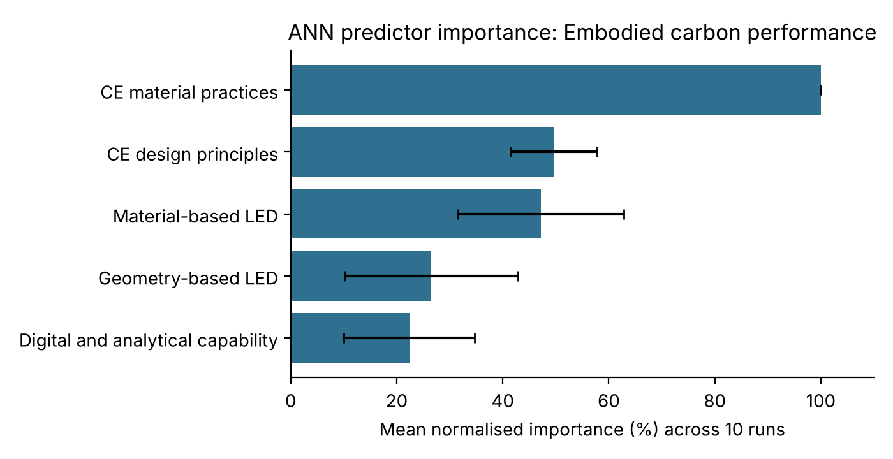

# Hybrid PLS-SEM and ANN analysis for circular economy and net-zero carbon buildings

This repository holds the second stage of a two-stage PLS-SEM and artificial neural network (ANN) analysis, written in Python. It belongs to my MSc thesis at KNUST, *Developing an integrated circular economy and net-zero carbon building framework for tropical developing countries: A hybrid PLS-SEM and artificial neural network approach* (in progress, 2026).

The structural model is estimated in SmartPLS 4. Its latent variable scores are then passed to a neural network to rank the predictors of each carbon outcome without assuming linear, compensatory relationships, following the hybrid procedure of Chan and Chong (2012) and Leong et al. (2020).

> **Data notice.** The file in `data/` is **synthetic**. It was simulated from the thesis's hypothesised model so that the code can be shared without exposing any respondent's answers. Fieldwork for the thesis has not yet been completed, and none of the numbers below are findings.

## The model

| Code | Construct | Role |
|---|---|---|
| CEDP | Circular economy design principles | Exogenous |
| CEMP | Circular economy material practices | Exogenous |
| GLED | Geometry-based low-energy design deployment | Mediator |
| MLED | Material-based low-energy design deployment | Mediator |
| DAIC | Digital and analytical capability | Moderator |
| OCP | Operational carbon performance | Outcome |
| ECP | Embodied carbon performance | Outcome |

The central question is whether circular economy practice and operational decarbonisation work together or pull in opposite directions. For example, material-based low-energy design (insulation, glazing, thermal mass) is hypothesised to improve operational carbon but carry an embodied-carbon penalty.

## What the code does

For each outcome (OCP and ECP), `src/ann_stage.py`:

1. Estimates the linear structural paths (standardised OLS on the latent scores, which reproduces the PLS-SEM inner model) to give a linear ranking of predictors.
2. Trains a multilayer perceptron with one hidden layer (sigmoid activation, identity output, standardised inputs).
3. Repeats training on ten random 90/10 train-test splits and reports training and testing RMSE as a mean and standard deviation.
4. Runs a sensitivity analysis: each input is held at its mean, and the resulting rise in RMSE is that input's importance. Importance is normalised against the largest value in each run and averaged across the ten runs.
5. Sets the ANN ranking beside the linear ranking. Where they differ, the network has picked up non-linear or interaction effects that the linear model misses.

## Example output (synthetic data, n = 385)

| Outcome | RMSE training, mean (SD) | RMSE testing, mean (SD) |
|---|---|---|
| Operational carbon performance | 0.675 (0.009) | 0.804 (0.070) |
| Embodied carbon performance | 0.685 (0.014) | 0.723 (0.083) |



In the synthetic data, digital and analytical capability has almost no linear path to embodied carbon (β = −0.02). It still keeps about 22% normalised importance in the network, because the simulation builds in a capability × material-based design interaction. This is the kind of divergence the hybrid design is meant to detect.

## How to run it

```bash
git clone https://github.com/bernard-frimpong/plssem-ann-hybrid.git
cd plssem-ann-hybrid
pip install -r requirements.txt

# 1. (optional) regenerate the synthetic data
python src/generate_synthetic_data.py --n 385 --seed 2026

# 2. run the ANN stage with the thesis defaults
python src/ann_stage.py --data data/synthetic_latent_scores.csv --outdir results

# or choose your own outcome and inputs, e.g. only the significant paths
python src/ann_stage.py --outcome OCP --inputs GLED MLED CEMP --outcome ECP --inputs CEMP CEDP MLED
```

To use real data, export the latent variable scores from SmartPLS 4 as a CSV whose column names match the construct codes, and pass it with `--data`.

## Outputs (`results/`)

| File | Contents |
|---|---|
| `rmse_<outcome>.csv` | Training and testing RMSE for each of the ten runs |
| `importance_runs_<outcome>.csv` | Normalised importance of each input in each run |
| `ranking_<outcome>.csv` | Path coefficients, linear rank, mean ANN importance, ANN rank and agreement |
| `importance_<outcome>.png` | Importance chart with standard-deviation error bars |

## Repository layout

```
plssem-ann-hybrid/
├── data/synthetic_latent_scores.csv
├── results/
├── src/
│   ├── generate_synthetic_data.py
│   └── ann_stage.py
├── requirements.txt
└── LICENSE
```

## References

- Chan, F. T. S., & Chong, A. Y.-L. (2012). A SEM–neural network approach for understanding determinants of interorganizational system standard adoption and performances. *Decision Support Systems, 54*(1), 621–630.
- Hair, J. F., Risher, J. J., Sarstedt, M., & Ringle, C. M. (2019). When to use and how to report the results of PLS-SEM. *European Business Review, 31*(1), 2–24.
- Leong, L.-Y., Hew, T.-S., Ooi, K.-B., & Wei, J. (2020). Predicting mobile wallet resistance: A two-staged structural equation modeling-artificial neural network approach. *International Journal of Information Management, 51*, 102047.

## Author

**Bernard Boakye Frimpong**, MSc Construction Management candidate, Kwame Nkrumah University of Science and Technology (KNUST), Ghana.
[GitHub](https://github.com/bernard-frimpong) · [Google Scholar](https://scholar.google.com/citations?user=fq_SHroAAAAJ&hl=en) · [ORCID](https://orcid.org/0009-0007-3664-3541)

Released under the MIT License.
